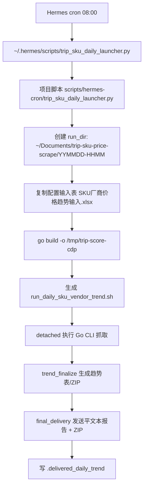

# 携程 SKU 动态抓取：当前运行机制与运营优化计划

> 生成时间：2026-06-20  
> 范围：Trip.com / 携程 SKU 价格、实价、趋势、厂商横向比价抓取任务  
> 核验依据：Hermes cron 列表、当前 launcher/watcher/final-delivery 脚本、Go `vendor_compare.go`、`trend_finalize.py`、当前 run `260620-0800` 输出样例与测试结果。  
> Codex handoff：本文件已放入程序工作区；当前 Hermes cron 定时任务已另存为 `.codex-handoff/current-hermes-cron-jobs-2026-06-20.md`，并在本文件第 11 节索引。

---

## 0. 当前结论摘要

| 事项 | 当前状态 | 运营判断 |
|---|---|---|
| 定时触发 | Hermes cron，启动器每天 08:00；watcher 每 60 分钟兜底监控/投递 | 机制已固定，符合“不要用 LaunchAgent”的偏好 |
| 主抓取 | Go CDP CLI：`mode1 + headless + normal + timeout=1800 + workers=3 + compare-vendor TSIM 網址` | 自动化程度够，但报告表达仍偏技术 |
| 平文本报告 | 有固定脚本范式，不是模型当场编 | 可读性稳定，但还不够运营友好 |
| Excel 输出 | 有固定程序范式，不是模型当场编 | 数据完整，但外放表字段过多、技术列太多 |
| 趋势比较 | 以前一次成功 run 为基准，按 `厂商 + 商品ID + SKU key` 匹配 | 可用，但需要把“价格变化”和“竞争优势”前置呈现 |
| 横向比价 | 按同一输入行的 TSim 与竞对产品做 SKU 规格匹配，仅用匹配 SKU 交集算差价 | 方向正确，应进一步做外放版表格精简和条件格式 |

---

## 1. 定时任务的具体触发方式和监控方式

### 1.1 触发方式

当前 SKU 动态抓取由 Hermes cron 触发，不是 macOS LaunchAgent。

| cron | job_id | 计划 | 脚本 | 模式 | 作用 |
|---|---:|---|---|---|---|
| SKU 每日价格趋势抓取-启动器 | `d3a8d581e5c9` | `0 8 * * *` | `trip_sku_daily_launcher.py` | `no_agent=true` | 每天 08:00 快速启动 detached 抓取任务 |
| SKU 每日价格趋势抓取-完成投递 | `eedb567db83c` | `every 60m` | `trip_sku_non_tsim_daily_watcher.py` | `no_agent=true` | 每小时检查进度；如果已完成但未投递，则补偿投递 |
| 一次性 Normal 模式拦截测试 | `b0a59be10c5e` | 2026-06-20 17:00 一次性 | `trip_sku_daily_launcher.py` | `no_agent=true` | 当前存在的一次性测试任务，用同一 launcher 启动 |

### 1.2 启动链路



当前主抓取参数来自 launcher：

```bash
/tmp/trip-score-cdp \
  --run-mode mode1 \
  --headless \
  --delay-profile normal \
  --timeout 1800 \
  --excel-input "$INPUT" \
  --workers 3 \
  --log-level verbose \
  --log-file run.jsonl \
  --compare-vendor 'TSIM 網址' \
  --output-dir "$RUN_DIR"
```

> 注：当前 `current_state.json` 的最新 run `260620-0800` 里 `headless=false`，但当前项目 launcher 代码是 `headless=true`。这说明存在“历史 run 状态”和“当前脚本默认值”不一致的现象；后续改造时应统一 state metadata、任务说明、实际 shell 命令三处。

### 1.3 监控方式

监控分三层：

| 层级 | 文件/脚本 | 作用 |
|---|---|---|
| 全局状态 | `~/Documents/trip-sku-price-scrape/current_state.json` | 指向当前 run，记录 `status/run_dir/vendors/total_urls/exit_code` |
| run 内状态 | `<run_dir>/current_state.json` | 记录当前 run 状态：`launched/running/scraped/failed/finalized` |
| 日志 | `<run_dir>/terminal_output.txt` + `run.jsonl` | 追踪 URL 进度、反爬、低质量、失败、最终 `run_done` |
| watcher | `trip_sku_non_tsim_daily_watcher.py` | 每小时输出进度，或在完成后兜底调用 final delivery |
| final delivery | `trip_sku_non_tsim_final_delivery.py` | 校验 run，生成最终平文本报告，投递到 Telegram 群 |

运行中进度报告范式：

```text
⏳ SKU价格抓取进行中 [YYMMDD-HHMM]
已运行: 40min | URL: 85/455 | 反爬拦截: 12次
  TSIM 網址: 15/128 (11%)
  BC: 30/57 (52%)
```

最终投递前校验重点：

- `current_state.json status == finalized`
- `exit_code.txt == 0`
- 存在最终 ZIP：`Trip_SKU厂商价格趋势_*.zip`
- 没有硬阻断 marker：`panic / partial export / stopped by signal`
- 记录软告警数量：`url_quality_failed / quality_rerun / cloudflare_overlay_detected / resourceId=0 / itemId=0 / risk challenge detected / whaleguard block / url failed`

---

## 2. 当前 Channel 平文本报告输出范式

### 2.1 是否固定？

**是固定的，不是模型当下编。**

平文本报告由：

```text
~/.hermes/scripts/trip_sku_non_tsim_final_delivery.py
  -> build_report()
  -> 调用 watcher.format_final()
```

最终内容由脚本拼接，投递用：

```bash
hermes send --to telegram:YOUR_DATA_GROUP --file <report.txt>
hermes send --to telegram:YOUR_OPERATIONS_GROUP --file <report.txt>
```

### 2.2 当前固定范式

```text
📊 SKU厂商价格趋势抓取 [YYMMDD-HHMM]

运行信息
- 关键告警：...
- 运行目录：YYMMDD-HHMM
- 对比基准：previous_run_id
- 运行耗时：X分钟
- 单URL平均速度：X.X秒

━━━━ TSIM 網址 ━━━━
实价上调Top5（按SKU平均涨降幅）
产品ID | 产品名 | +X.XX
实价下调Top5
产品ID | 产品名 | -X.XX
销量增长Top5（按增长百分比与绝对数50:50权重）
产品ID | 产品名 | +N

━━━━ BC ━━━━
...

━━━━ TSIM 網址 vs 竞对比价 ━━━━
BC | 62地区 4418SKU匹配 | 均价差: +2.45 | 基准更优: 52% | 基准更优
...

MEDIA:/path/to/Trip_SKU厂商价格趋势_YYMMDD-HHMM.zip
```

### 2.3 当前运营问题

| 问题 | 影响 |
|---|---|
| 先按厂商列 Top5，而不是先说“今天最值得运营关注什么” | 运营读者需要自己判断重点 |
| 上调/下调是“产品内 SKU 平均涨跌”，但未说明影响范围 | 不知道是单 SKU 异动还是大面积变价 |
| `销量增长Top5` 现在按产品聚合时存在重复 SKU 累加风险 | watcher 当前代码对 `预定数变化` 是逐 SKU 累加，容易放大产品销量变化 |
| 比价区只有均价差和基准更优比例 | 缺少“哪些目的地/产品 TSim 丢优势或优势扩大” |
| 软告警直接列技术 marker | 运营人员难以理解实际风险 |

---

## 3. 当前输出结果表格范式

### 3.1 是否固定？

**是固定的，由 Go CLI 和 Python finalizer 生成，不是模型当下编。**

当前 run `260620-0800` 已验证存在这些固定文件：

| 文件 | 作用 |
|---|---|
| `<vendor>_260620-0800.xlsx` | 每厂商原始 SKU/价格抓取结果 |
| `<vendor>_260620-0800_含趋势.xlsx` | 每厂商附加前次趋势列 |
| `SKU厂商价格趋势总表_260620-0800.xlsx` | 全厂商趋势总表，含全量明细/新产品新SKU/本次缺失SKU/摘要 |
| `vendor_compare_260620-0800.xlsx` | 横向比价表，含汇总/总表/单链接均价/厂商 pair sheet |
| `vendor_compare_260620-0800.json` | 平文本报告读取的横向比价摘要 JSON |
| `Trip_SKU厂商价格趋势_260620-0800.zip` | 最终投递包 |

### 3.2 当前 `vendor_compare` 工作表结构

当前 `vendor_compare_260620-0800.xlsx` 工作表：

```text
汇总
总表_横向比价
单链接均价对比
JY_vs_TSIM 網址
其他_vs_TSIM 網址
BC_vs_TSIM 網址
TGT_vs_TSIM 網址
FR_vs_TSIM 網址
其他2_vs_TSIM 網址
其他3_vs_TSIM 網址
```

#### `总表_横向比价`

- SKU 粒度。
- 横向矩阵布局。
- 每行 = 一个输入行/目的地 + 一个结构化 SKU 规格。
- 当前有 2 行表头：第 1 行为合并厂商块，第 2 行为字段。
- 当前列数很多，最新样例为 `16179 行 × 132 列`。

当前基础字段：

```text
输入行号, 分類, 目的地, 规范SKU层级1, 规范SKU层级2,
有效期天数, 流量类型, 流量MB, 匹配厂商数, 匹配规则,
匹配置信度, 基准厂商
```

当前每个厂商块字段：

```text
商品ID, 商品名称, 原始SKU1, 原始SKU2, 货币, 外显价格, 实价, 促销标签,
预定数, 评价数, 评分, 同规格候选数, 相对基准实价差,
相对基准最低价差, 价格结论
```

#### `单链接均价对比`

- 目的地/输入行粒度。
- 每行 = 一个输入表产品组/目的地。
- 计算逻辑：只用重合 SKU 的实价均价差，不允许用不重合 SKU 做产品平均比较。
- 当前样例为 `121 行 × 118 列`，字段过宽。

当前基础字段包括：

```text
输入行号, 分類, 目的地, 基准厂商, 参与厂商数, 有重合SKU的竞对数,
总SKU规格数, 基准SKU数, 竞对独有SKU数, 基准独有SKU数,
综合最低均价厂商, 综合最低均价, 综合最高均价厂商, 综合最高均价,
最高-最低均价差, 基准综合均价, 基准综合排名, 基准是否综合最低,
基准较最低均价差, 基准较最低均价差%
```

每个竞对厂商字段包括：

```text
重合SKU数, 重合SKU覆盖率%, 竞对重合SKU均价, 基准重合SKU均价,
相对基准均价差, 相对基准均价差%, vs基准结论,
竞对低于基准SKU数, 基准低于竞对SKU数, 持平SKU数,
竞对独有SKU数, 基准独有SKU数, 综合均价, 综合排名
```

---

## 4. 运营视角：当前机制与范式修改计划

### 4.1 总体目标

把当前“技术完整表”拆成两层：

| 层级 | 给谁看 | 原则 |
|---|---|---|
| 外放运营版 | Telegram / 日常运营读者 | 少列、强结论、突出价格变化、趋势、竞争优势 |
| 内部诊断版 | Agent / 开发 / 排错 | 保留全部技术字段、匹配置信度、输入行号、候选数、诊断 marker |

### 4.2 平文本报告改造计划

建议把最终报告从“厂商 Top5 堆叠”改成以下结构：

```text
📊 SKU价格与竞对趋势 [YYMMDD-HHMM]

运行概览
- 覆盖：501 URL / 8厂商 / 基准：TSIM 網址 / 对比：260619-0800
- 数据健康：成功 / 软告警 N 项 / 需复核产品 M 个

今日重点
1. 价格上调最明显：厂商A / 目的地X / +HK$X.XX / 影响Y个SKU
2. 价格下调最明显：厂商B / 目的地Y / -HK$X.XX / 影响Y个SKU
3. TSim优势扩大：目的地Z / 相对竞对均价差 +HK$X.XX
4. TSim优势减弱：目的地W / 相对竞对均价差 -HK$X.XX

价格变化
- 上调Top5：...
- 下调Top5：...

竞争优势
- TSim低于竞对：...
- TSim高于竞对：...
- 接近持平：...

销量/热度变化
- 预定数增长Top5：...

附件
MEDIA:/path/to/zip
```

保留固定脚本生成，不交给模型临场总结。

### 4.3 Excel 报告改造计划

建议输出 3 套表：

| 文件/工作表 | 用途 | 外放？ |
|---|---|---|
| `运营摘要.xlsx` | 运营每天打开优先看 | 是 |
| `横向比价_运营版.xlsx` | 看 TSim vs 竞对价格优势 | 是 |
| `完整诊断包.zip` | 保留原始表、日志、JSON、技术字段 | 是，但作为附件内部留档 |

运营版表建议工作表：

1. `今日摘要`
2. `价格变化Top`
3. `TSim_vs竞对优势`
4. `单链接均价对比_精简`
5. `横向比价_精简`
6. `销量与评分趋势_Mode2`（由 mode2 独立产生）
7. `数据健康检查`

---

## 5. 当前程序如何处理“和前一天/前一次价格不同”

### 5.1 趋势基准选择

`trip_sku_trend_finalize.py` 会寻找当前 run 之前最近一个成功 run：

```text
find_previous_run(current)
```

成功 run 条件：

- 目录名早于当前 run。
- 存在 `exit_code.txt`。
- `exit_code.txt == 0`。
- 至少存在某个厂商的原始 XLSX。

### 5.2 匹配键

趋势比较的匹配粒度是：

```text
厂商 + 商品ID + SKU key
```

其中：

- `商品ID` 优先来自 XLSX 的 `商品ID`。
- 如果没有，则从 URL `/detail/<数字ID>` 提取。
- SKU key 当前为原始 SKU 层级归一化拼接：`SKU层级1|SKU层级2|...`。

### 5.3 写入趋势列

当前 trend finalizer 给每个厂商的 `*_含趋势.xlsx` 追加列：

```text
对比基准日期, 对比基准目录, 趋势匹配状态,
前次外显价格, 外显价格变化, 外显价格变化百分比, 外显价格趋势,
前次实价, 实价变化, 实价变化百分比, 实价趋势,
前次促销标签, 促销标签变化,
前次预定数, 预定数变化, 预定数变化百分比, 预定数趋势,
前次评价数, 评价数变化, 评价数变化百分比,
前次评分, 评分变化, 评分趋势,
前次客户服务, 客户服务变化,
前次方便程度, 方便程度变化,
前次讯号状态, 讯号状态变化,
前次中差评价数, 中差评价数变化
```

趋势状态：

| 状态 | 含义 |
|---|---|
| `匹配成功` | 同厂商、同商品、同 SKU 在前次存在 |
| `新SKU` | 同商品存在，但该 SKU 是新的 |
| `新产品` | 前次没有该商品 |
| `无前次基准` | 没有可用历史 run |
| `前次存在本次缺失` | 前次有，本次没有匹配到 |

### 5.4 平文本报告如何使用价格变化

watcher 当前读取各 `*_含趋势.xlsx`：

- 商品ID：第 B 列。
- 商品名称：第 D 列。
- 实价变化：第 AA 列。
- 预定数变化：第 AG 列。
- 预定数变化百分比：第 AH 列。

然后按产品聚合：

| 报告项 | 当前算法 |
|---|---|
| 实价上调 Top5 | 产品内所有 SKU 的 `实价变化` 求平均，筛选 `>= 0.2` |
| 实价下调 Top5 | 产品内所有 SKU 的 `实价变化` 求平均，筛选 `<= -0.1` |
| 销量增长 Top5 | 预定数增长绝对值和百分比各 50% 加权 |

### 5.5 Excel 报告如何体现价格变化

当前 Excel 有两类：

| 表 | 价格变化呈现 |
|---|---|
| `*_含趋势.xlsx` | 每 SKU 行追加前次价格、变化值、变化百分比、趋势文字 |
| `SKU厂商价格趋势总表_*.xlsx` | 汇总所有厂商趋势，并有新产品新SKU、本次缺失SKU、摘要 sheet |
| `vendor_compare_*.xlsx` | 横向比较当前 run 的 TSim vs 竞对，不依赖前次价格 |

---

## 6. 对用户开发想法的可行性评估与落地计划

### 6.1 Vendor compare 表：横向比价总表

#### 建议采纳

| 用户想法 | 建议 | 说明 |
|---|---|---|
| `输入行号/有效期天数/流量类型/流量MB/匹配厂商数/匹配规则/匹配置信度` 不外放 | 采纳 | 留在内部诊断版；外放版只保留 `分類/目的地/规范SKU/厂商价格差` |
| 基准厂商块里的 `同规格候选数/相对基准实价差/相对基准最低价差/价格结论` 不外放 | 采纳 | 基准自身不需要“相对自己”的字段 |
| 竞对 `相对基准实价差` 用条件格式 | 采纳 | `>0` 表示竞对更贵/基准更低，应绿色；`<0` 表示竞对更低/基准较贵，应红色 |
| 商品名称不要 | 部分采纳 | SKU 级横向表可以去掉；摘要表建议保留短产品名，便于人读 |
| 预定数/评价数/评分不要 | 采纳 | 从价格横向表移走，放到 mode2 趋势表 |

#### 推荐外放列

`总表_横向比价_运营版`：

```text
分類
目的地
规范SKU
TSIM_实价
BC_实价
BC_相对TSIM实价差
TGT_实价
TGT_相对TSIM实价差
FR_实价
FR_相对TSIM实价差
JY_实价
JY_相对TSIM实价差
其他_实价
其他_相对TSIM实价差
价格结论
```

内部诊断版继续保留：

```text
输入行号, 有效期天数, 流量类型, 流量MB, 匹配厂商数,
匹配规则, 匹配置信度, 同规格候选数, 原始SKU, 商品ID, 商品名称等
```

### 6.2 单链接均价对比表

#### 建议采纳

| 用户想法 | 建议 | 说明 |
|---|---|---|
| 以所有厂商共同设置的 SKU 规格进行对比 | 谨慎采纳 | 可增加“全厂商共同 SKU 均价”指标；但也要保留“TSim vs 单个竞对重合 SKU”，否则某些厂商缺 SKU 会导致整行不可比 |
| 隐藏参与厂商数、重合SKU数、覆盖率等技术字段 | 外放版采纳 | 内部版保留，否则无法诊断比较可信度 |
| 精神是重合 SKU 均价差 + 重合 SKU 最低价差 | 采纳 | 这是运营最关心的两个价格优势指标 |
| 表头做大的合并单元格厂商标识 | 采纳 | 当前横向比价已有合并厂商块，单链接表也应同步改造 |

#### 推荐外放列

`单链接均价对比_运营版`：

```text
分類
目的地
TSIM_重合SKU均价
TSIM_重合SKU最低价
BC_均价差
BC_最低价差
BC_结论
TGT_均价差
TGT_最低价差
TGT_结论
FR_均价差
FR_最低价差
FR_结论
JY_均价差
JY_最低价差
JY_结论
综合结论
```

### 6.3 趋势表

#### 建议采纳

| 用户想法 | 建议 | 说明 |
|---|---|---|
| 预定数/评价数/评分/小项评分/商品资讯及趋势单独放工作表，按 mode2 跑 | 采纳 | 价格抓取和评分/销量趋势拆开，报表更清晰 |
| 前次促销标签和促销标签列重复 | 采纳优化 | 改成：`促销标签变化`，只在变化时显示 `旧 -> 新` |
| 前次外显价格和外显价格列重复 | 采纳优化 | 外放版只保留 `前次标价/本次标价/标价变化`，必要时折叠 |
| `外显价格` 改为 `标价` | 采纳 | 对运营更自然；内部字段可保留原名，外放表改名 |
| 对比基准目录不要写 | 外放版采纳 | 只写 `对比基准日期`；完整目录留内部 JSON/诊断包 |
| 实价趋势和标价趋势用上下箭头 + 条件格式 | 采纳 | `↑` 红、`↓` 绿、`→` 灰 |
| 分厂商分工作表 | 部分采纳 | 外放趋势表建议一个“总览”+ 分厂商 sheet；避免打开后过宽 |

#### 推荐趋势列

`价格趋势_运营版`：

```text
厂商
分類
目的地
商品ID
短产品名
SKU规格
前次实价
本次实价
实价变化
实价趋势
前次标价
本次标价
标价变化
标价趋势
促销标签变化
趋势状态
```

### 6.4 抓取程序本身

| 用户想法 | 建议 | 说明 |
|---|---|---|
| 自然语言目标抓取和自动抓取范式保持一致 | 采纳 | ad-hoc 抓取也应走同一 run_dir、任务说明、参数记录、趋势/比价 finalizer |
| 抓友商指定表产品时，是否同时抓 TSim | 默认应同时抓 | 因为运营核心是“相比本家优势与否”；除非明确只要友商快照 |
| 同一商品内 SKU 排序：规格容量一级、天数二级 | 采纳，但建议排序优先级反过来讨论 | 当前横向比价排序是天数优先、数据类型、流量。用户要求应改为：流量容量/类型优先，天数第二 |

推荐新排序：

```text
流量类型（每日/总量/无限）
流量MB
有效期天数
厂商顺序
原始SKU
```

如果运营更常按“1GB 套餐在不同天数下的价差”看，则采用此排序更好。

---

## 7. 价格变化报告的优化计划

### 7.1 当前不足

| 当前机制 | 问题 |
|---|---|
| 按厂商列出实价上调/下调 Top5 | 看不到“TSim 是否仍有优势” |
| 产品内 SKU 平均涨跌 | 看不到影响 SKU 数、最大涨跌 SKU、是否局部异常 |
| 比价只看当前 run | 看不到“优势扩大/缩小”的趋势 |
| 销量增长混在价格报告里 | 会干扰价格判断 |

### 7.2 运营友好的平文本报告改法

建议增加 4 个核心板块：

#### A. 今日价格异动

```text
价格异动
- 上调：BC 日本 +HK$2.30（影响 12/38 个重合SKU）
- 下调：FR 欧洲 -HK$4.10（影响 18/72 个重合SKU）
- 无明显变化：TSIM 香港主产品
```

#### B. TSim 竞争优势变化

```text
TSim 价格优势
- 优势扩大：日本 vs BC，均价差从 +HK$1.20 到 +HK$2.80
- 优势缩小：欧洲 vs FR，均价差从 +HK$18.00 到 +HK$10.50
- 转为劣势：泰国 vs TGT，本次 TGT 低 HK$1.60
```

#### C. 目的地/产品级行动信号

```text
需关注
1. TSim 高于 2 个以上竞对：目的地X / 主要差距 HK$3.20
2. 竞对突然降价：厂商Y / 目的地Z / -HK$5.50
3. TSim 突然上调：产品ID... / +HK$2.00
```

#### D. 数据健康

```text
数据健康
- 价格可信：正常
- 低质量重跑：N URL
- 反爬/Cloudflare：M 次，仅作备注
```

### 7.3 运营友好的 Excel 优化

#### `今日摘要` sheet

```text
指标
本次run
对比run
总URL
成功URL
有价格变化产品数
TSim优势目的地数
TSim劣势目的地数
竞对降价产品数
需人工复核数
```

#### `价格变化Top` sheet

```text
方向
厂商
分類
目的地
商品ID
短产品名
影响SKU数
平均实价变化
最大SKU变化
前次均价
本次均价
结论
```

#### `TSim_vs竞对优势` sheet

```text
分類
目的地
竞对厂商
重合SKU数
TSim均价
竞对均价
本次均价差(竞对-TSim)
前次均价差
优势变化
TSim更低SKU占比
最低价差
结论
```

条件格式：

| 字段 | 规则 |
|---|---|
| `本次均价差(竞对-TSim)` | 正数绿色：TSim 低；负数红色：TSim 高 |
| `优势变化` | 正数绿色：优势扩大；负数红色：优势缩小 |
| `实价变化` | 上涨红色；下降绿色 |
| `趋势箭头` | `↑` 红，`↓` 绿，`→` 灰 |

### 7.4 关键算法建议

| 目标 | 推荐算法 |
|---|---|
| 产品价格变化 | 同厂商同商品同 SKU：本次实价 - 前次实价；产品层用匹配 SKU 平均 |
| 竞对优势 | 同输入行同 SKU：竞对实价 - TSim 实价；正数代表 TSim 更低 |
| 优势趋势 | 本次均价差 - 前次均价差；正数代表 TSim 优势扩大 |
| 最低价优势 | 只在重合 SKU 交集内取最低价，不跨不重合 SKU 比 |
| 销量增长 | 产品级字段只算一次，不按 SKU 行重复累加 |
| 数据可信度 | 匹配 SKU 数、覆盖率、低质量 URL、风险 marker 作为内部字段，不默认外放 |

---

## 8. 建议实施顺序

### Phase 1：不改抓取，只改报告外放版

- [ ] 在 finalizer 后新增 `运营摘要生成器`。
- [ ] 读取现有 `*_含趋势.xlsx` 与 `vendor_compare_*.json/xlsx`。
- [ ] 生成 `运营摘要.xlsx`。
- [ ] 平文本报告改成“运行概览 + 今日重点 + 价格变化 + TSim竞争优势 + 数据健康”。
- [ ] 保留原 ZIP 完整包。

### Phase 2：精简 vendor_compare 外放表

- [ ] 保留当前完整 `vendor_compare_*.xlsx` 作为内部诊断版。
- [ ] 新增 `vendor_compare_运营版.xlsx`。
- [ ] 删除/隐藏用户指定的技术列。
- [ ] 增加条件格式。
- [ ] `外显价格` 在外放表统一改名为 `标价`。

### Phase 3：趋势表重构

- [ ] 价格趋势和商品评分/预定数趋势拆表。
- [ ] mode2 每日或定期生成 `销量评分趋势.xlsx`。
- [ ] 修正销量增长产品聚合：产品级字段只计算一次。
- [ ] 删除外放表里的 `对比基准目录`，保留 `对比基准日期`。

### Phase 4：抓取入口统一

- [ ] 自然语言临时抓取也写入标准 run_dir。
- [ ] 默认如果抓竞对，自动带上对应 TSim URL。
- [ ] 所有 run 都写 `任务说明.md/current_state.json/run.jsonl/terminal_output.txt`。
- [ ] SKU 排序改为用户要求的“同规格容量优先，天数第二”。

---

## 9. 当前已核验事实

| 核验项 | 结果 |
|---|---|
| Hermes 版本 | `Hermes Agent v0.16.0 (2026.6.5)` |
| SKU 内部 Go 测试 | `go test ./internal/tripcdp ...` 通过 |
| 最新状态文件 | `260620-0800`，`status=finalized`，`exit_code=0` |
| 最新 run 总 URL | 501 |
| 最新 run 厂商 | `TSIM 網址, BC, TGT, FR, JY, 其他, 其他2, 其他3` |
| 最新 compare 表 | `vendor_compare_260620-0800.xlsx`，含 10 个 sheet |
| 最新趋势总表 | `SKU厂商价格趋势总表_260620-0800.xlsx`，含 4 个 sheet |
| 最新 ZIP | `Trip_SKU厂商价格趋势_260620-0800.zip` |

---

## 10. 最终建议

短期不要重写抓取主流程。当前抓取、趋势、比价的底层逻辑是可用的，优先改“外放报告层”。

最值得先做的三件事：

1. **新增运营版报告生成器**：保留完整数据，但外放只给运营要看的价格变化、竞争优势、趋势结论。
2. **新增运营版 Excel**：不要删除原始诊断表，另出精简表，隐藏技术字段并加条件格式。
3. **修正销量聚合和优势趋势**：销量按产品只算一次；比价增加“前次差价 vs 本次差价”，让运营直接看到 TSim 优势扩大还是缩小。

---

## 11. 当前正在运行/启用的 Hermes Cron 描述文件

本节不是摘要，而是给 Codex 的文件索引。完整定时任务描述已作为独立 Markdown 放入程序工作区：

```text
/Users/example/Develop/trip-score-price-scraper/.codex-handoff/current-hermes-cron-jobs-2026-06-20.md
```

其中包含：

| 文件内条目 | job_id | 与本程序关系 |
|---|---:|---|
| `cron/trip-sku-daily-launcher.yaml` | `d3a8d581e5c9` | SKU 主启动器，直接相关 |
| `cron/trip-sku-daily-watcher-delivery.yaml` | `eedb567db83c` | SKU watcher/完成投递，直接相关 |
| `cron/trip-sku-one-shot-normal-interception-test.yaml` | `b0a59be10c5e` | SKU 一次性诊断，直接相关但非长期输出入口 |
| `cron/trip-outerlist-daily-full-builtin-compare-xlsx.yaml` | `3476b2c48c71` | Trip Outerlist，不属于 SKU 程序 |
| `cron/ctrip-comment-daily-mid-bad-export.yaml` | `8c58be5afe1c` | 携程评价日报，不属于 SKU 程序 |
| `cron/ctrip-comment-weekly-mid-bad-export.yaml` | `b82469836319` | 携程评价周报，不属于 SKU 程序 |
| `cron/kkday-comment-daily-export.yaml` | `50e3a7e31dc4` | KKday 评论日报，不属于 SKU 程序 |

Codex 应优先把前三个 SKU 相关 cron 与以下文件一起看：

```text
scripts/hermes-cron/trip_sku_daily_launcher.py
scripts/hermes-cron/trip_sku_trend_finalize.py
~/.hermes/scripts/trip_sku_non_tsim_daily_watcher.py
~/.hermes/scripts/trip_sku_non_tsim_final_delivery.py
internal/tripcdp/vendor_compare.go
.hermes/skills/trip-sku-price-scraper-operations/SKILL.md
docs/sku-dynamic-report-operations-optimization-2026-06-20.md
```
